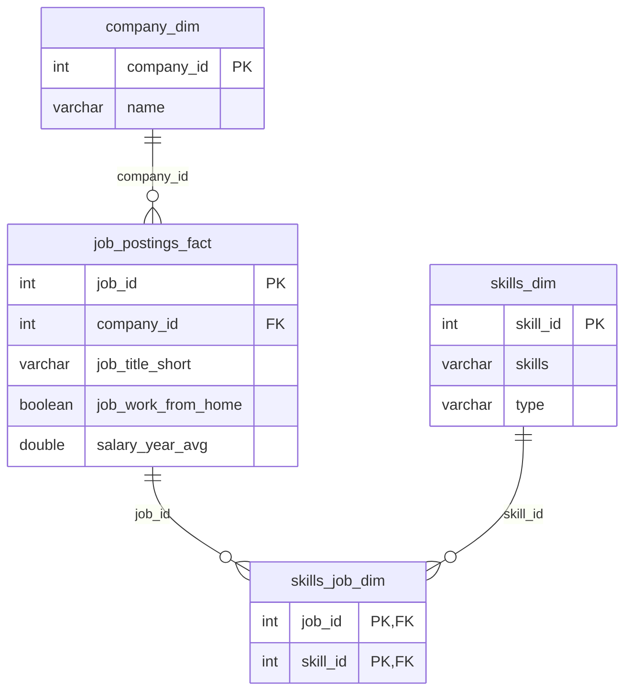

# Exploratory Data Analysis with SQL: Data Engineer Job Market

This is an end-to-end SQL Exploratory Data Analysis (EDA) project analyzing the **remote Data Engineer** job market using real-world job postings. It demonstrates how to design multi-table analytical queries, apply statistical aggregations, and translate raw warehouse data into actionable career insights.

---

## Executive Summary

- **Scope:** Built **3 progressive SQL analytical queries** exploring demand, compensation, and the optimal trade-off between both for remote Data Engineer roles.
- **Data Modeling:** Queried a star-schema data warehouse (`data_jobs`) by joining fact (`job_postings_fact`), bridge (`skills_job_dim`), and dimension (`skills_dim`) tables.
- **Analytics:** Used `INNER JOIN`, `MEDIAN()`, `LN()` logarithmic scaling, `GROUP BY`, `HAVING`, and `NULL` filtering to prevent skewed metrics.
- **Outcomes:** Identified **SQL & Python** as the highest-demand core skills, **Rust & Terraform** among the highest-paying skills, and **Terraform, Python, AWS, SQL, Airflow, Spark, & Kafka** as the most optimal skills overall.

### Quick Links to Queries
1. [`01_Top_demand_skills.sql`](./01_Top_demand_skills.sql) — Top 10 most in-demand skills for remote Data Engineers.
2. [`02_top_paying_skills.sql`](./02_top_paying_skills.sql) — Top 25 highest-paying skills (by median annual salary, `demand > 100`).
3. [`03_optimal_skills.sql`](./03_optimal_skills.sql) — Top 25 most optimal skills balancing demand (`LN`) and median salary.

---

## Problem & Context

Acting as a job market analyst using the `data_jobs` data warehouse (hosted on **MotherDuck** and queried via **DuckDB**), this project answers three core questions for aspiring and practicing Data Engineers:

1. **What skills are most in demand** for remote Data Engineer positions?
2. **Which skills command the highest median salaries** when filtered for meaningful job market demand?
3. **Which skills offer the best balance** between high demand and high compensation?

### Data Warehouse Schema (`data_jobs`)

- **`job_postings_fact` (Fact Table):** Stores individual job postings, role categories, remote-work flags, and annual salary averages.
- **`skills_job_dim` (Bridge Table):** Resolves the many-to-many relationship between job postings and required skills using a composite primary key (`job_id`, `skill_id`).
- **`skills_dim` (Dimension Table):** Stores standardized skill names and skill categories.
- **`company_dim` (Dimension Table):** Stores company metadata referenced by `company_id`.

---

## Tech Stack

- **Database & Query Engine:** DuckDB (`v1.5.6`) & MotherDuck (Cloud Data Warehouse)
- **Language:** SQL
- **Editor & Terminal:** Antigravity IDE / VS Code & Git Bash
- **Version Control:** Git & GitHub

---

## Analysis Overview

### 1. Top Demanded Skills ([`01_Top_demand_skills.sql`](./01_Top_demand_skills.sql))
Finds the top 10 most frequently requested skills for remote Data Engineer postings using `INNER JOIN` (excluding postings without listed skills).

| Rank | Skill | Demand Count |
| :---: | :--- | :---: |
| 1 | `sql` | 29,221 |
| 2 | `python` | 28,776 |
| 3 | `aws` | 17,823 |
| 4 | `azure` | 14,143 |
| 5 | `spark` | 12,799 |
| 6 | `airflow` | 9,996 |
| 7 | `snowflake` | 8,639 |
| 8 | `databricks` | 8,183 |
| 9 | `java` | 7,267 |
| 10 | `gcp` | 6,446 |

**Key Takeaways:** SQL and Python are virtually mandatory (~29K postings each), while cloud providers (AWS, Azure, GCP) and big-data/orchestration tools (Spark, Airflow, Snowflake, Databricks) round out the top 10.

---

### 2. Top Paying Skills ([`02_top_paying_skills.sql`](./02_top_paying_skills.sql))
Evaluates the top 25 highest-paying skills using `MEDIAN(salary_year_avg)` (to resist salary outliers) and `HAVING COUNT(jpf.*) > 100` (to filter out niche noise).

| Highlight | Skill | Median Salary (USD) | Demand Count |
| :--- | :--- | :---: | :---: |
| Highest Median | `rust` | $210,000 | 232 |
| High Pay + Solid Demand | `terraform` | $184,000 | 3,248 |
| High Pay + Niche | `golang` | $184,000 | 912 |
| High Demand + Strong Pay | `kubernetes` | $150,500 | 4,202 |
| Top 10 Demand + Strong Pay | `airflow` | $150,000 | 9,996 |

**Key Takeaways:** Specialized systems and infrastructure tools pay the highest medians, while foundational skills like SQL and Python sit below the top 25 median because they appear across all seniority levels.

---

### 3. Most Optimal Skills ([`03_optimal_skills.sql`](./03_optimal_skills.sql))
Combines salary and demand into a single `optimal_score`:

$$\text{optimal\_score} = \frac{\text{MEDIAN}(\text{salary\_year\_avg}) \times \ln(\text{COUNT}(\text{postings}))}{1{,}000{,}000}$$

Filtering `jpf.salary_year_avg IS NOT NULL` in `WHERE` ensures demand counts only reflect salary-verified postings and prevents `LN(0)` domain errors.

| Rank | Skill | Median Salary (USD) | Salary-Verified Demand | `LN(Demand)` | Optimal Score |
| :---: | :--- | :---: | :---: | :---: | :---: |
| 1 | `terraform` | $184,000 | 193 | 5.3 | **0.97** |
| 2 | `python` | $135,000 | 1,133 | 7.0 | **0.95** |
| 3 | `aws` | $137,320 | 783 | 6.7 | **0.91** |
| 4 | `sql` | $130,000 | 1,128 | 7.0 | **0.91** |
| 5 | `airflow` | $150,000 | 386 | 6.0 | **0.89** |
| 6 | `spark` | $140,000 | 503 | 6.2 | **0.87** |
| 7 | `kafka` | $145,000 | 292 | 5.7 | **0.82** |
| 8 | `snowflake` | $135,500 | 438 | 6.1 | **0.82** |

**Key Takeaways:** Applying natural logarithm (`LN`) prevents massive demand counts (Python, SQL) from completely drowning out salary. Infrastructure-as-code (**Terraform**) and core data engineering tools (**Python, AWS, SQL, Airflow, Spark, Kafka, Snowflake**) offer the best return on learning investment.

---

## SQL Skills Demonstrated

- **Query Design & Optimization:** Multi-table `INNER JOIN` chaining across fact, bridge, and dimension tables; precise filtering with `WHERE` and `HAVING`; sorting and row limiting (`ORDER BY`, `LIMIT`).
- **Data Analysis Techniques:** Aggregation with `COUNT()` and outlier-resistant `MEDIAN()`, logarithmic scaling with `LN()`, custom calculated ranking metrics, `ROUND()` formatting, and `NULL` handling aligned with SQL Order of Execution.
